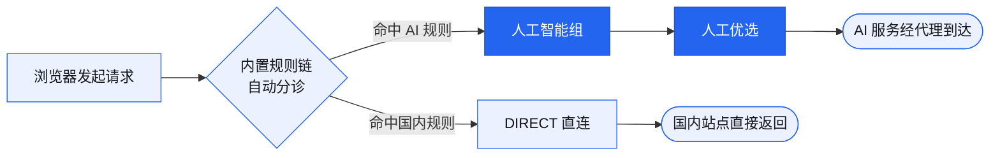
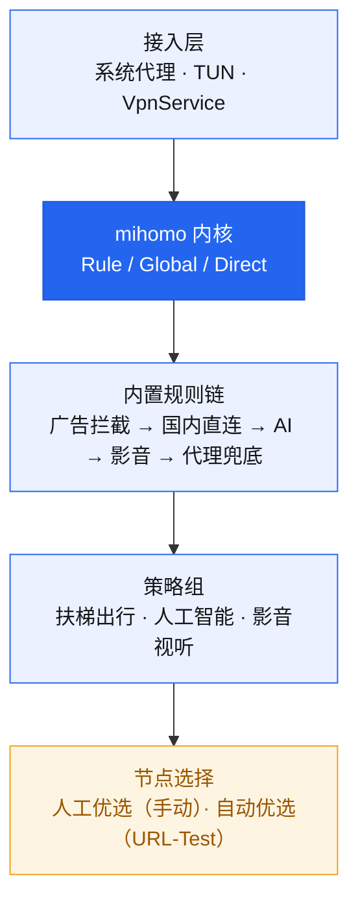
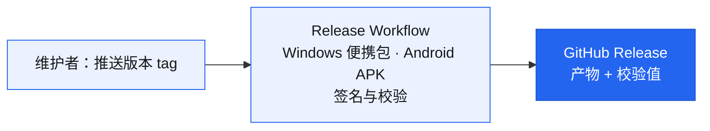

# ClashEdge

轻量便携的 Mihomo 客户端，支持智能分流，开箱即用。

[下载](../../releases) · [快速开始](#快速开始) · [文档](docs/index.md) · [常见问题](docs/faq.md)

> 新手请从 **这是什么** 读到 **快速开始**。想理解分流原理，看 [进阶](#进阶分流体系如何工作)。

## 这是什么

ClashEdge 是一个 Mihomo 图形客户端（Mihomo 是 Clash 内核的活跃延续，ClashEdge 负责把它包装成开箱即用的桌面与移动应用）。你提供订阅链接，它负责规则分流、节点选择与系统接入。

- **便携优先**：Windows 解压即用，程序与数据分离（`App/` + `Data/`），复制文件夹即整体迁移。
- **开箱即用**：内置规则链与策略组，订阅只提供节点，无需手写任何规则。
- **内核托管**：mihomo 配置由应用统一生成并守护——崩溃自启、端口预检、热重载。

| 平台 | 状态 | 网络接入 | 分发形态 |
| --- | --- | --- | --- |
| **Windows** | ✅ 正式版 | 系统代理 · TUN（Wintun） | 便携目录 |
| **Android** | 🔶 预览版 | VpnService（TUN） | APK |

> Android 预览版自 v0.1.0 起随 [Release](../../releases) 发布，界面与 VPN 授权流程完整可体验；Mihomo 内核（AAR/JNI）仍为占位实现，暂无真实代理。正式版前置条件见 [`apps/android/README.md`](apps/android/README.md)。

## 一个例子

导入订阅后，你在浏览器打开一个 AI 站点——

整个过程无需任何配置：广告被拦截、国内流量直连、AI 与影音流量各走各的出口。

## 快速开始

### Windows

| 步骤 | 操作 |
| --- | --- |
| 1 | 从 [Releases](../../releases) 下载 `ClashEdge-portable-win64.zip`，解压到任意目录（建议非系统盘） |
| 2 | 运行 `ClashEdge.exe`，首次启动自动创建 `Data` 目录 |
| 3 | 左侧「订阅」→「添加订阅」，粘贴订阅链接 |
| 4 | 首页「启动核心」，状态变为「已连接」 |
| 5 | 开启「系统代理」或「TUN 模式」 |

### Android

下载 [Release](../../releases) 中的 `ClashEdge-android-<version>.apk` → 安装（允许未知来源）→ 授予 VPN 权限 → 添加订阅 → 启动核心。

### 常见问题

- **TUN 模式**：需要管理员权限，程序会自动请求 UAC 提权。
- **杀毒软件误报**：属未签名便携程序的常见现象，可添加信任，说明见 [FAQ](docs/faq.md)。
- **订阅与配置细节**：见 [配置详解](docs/configuration.md)。

## 进阶：分流体系如何工作

| 策略组 | 类型 | 说明 |
| --- | --- | --- |
| **扶梯出行** | Select | 主出口组：自动 / 人工优选 + DIRECT |
| **人工智能** | Select | AI 服务专用出口 |
| **影音视听** | Select | 流媒体专用出口 |
| **人工优选** | Select | 全部订阅节点，纯手动选择 |
| **自动优选** | URL-Test | 每 5 分钟测速，自动选最低延迟（容差 100ms） |
| **GLOBAL** | Select | Global 模式专用，规则模式下隐藏 |

内置规则集（[akaspyrean/external](https://github.com/akaspyrean/external)）：direct 11.1 万 / ad 21.6 万 / proxy 2.7 万 / media 1.6 千 / ai 82 条，经签名清单校验，每日自动更新。

## 仓库结构

| 目录 | 内容 |
| --- | --- |
| `apps/windows/` | Windows 客户端（Tauri 2：Rust 后端 + Vue 3 前端） |
| `apps/android/` | Android 客户端（Kotlin + Jetpack Compose） |
| `docs/` | 用户文档、架构与设计规范、审计报告 |
| `design/` `packaging/` `scripts/` | 设计资源、打包配置与构建脚本 |

## 维护者参考

### 本地检查

以下检查在 CI 中统一执行，本地运行用于提前发现问题。

| 命令 | 作用 |
| --- | --- |
| `cd apps/windows/src-tauri && cargo fmt --check` | Rust 格式检查 |
| `cargo clippy --all-targets -- -D warnings` | Rust 静态检查（警告即失败） |
| `cargo test` | Rust 单元测试 |
| `cargo audit` / `cargo deny` | 依赖漏洞与许可审计 |
| `cd apps/windows && npm test` | 前端单元测试 |

### 发布

- 版本号只来自手动推送的 tag，仓库内版本字段不参与决定。
- 构建与签名细节见[构建与发布](docs/build-release.md)。

### 文档

[快速上手](docs/getting-started.md) · [配置详解](docs/configuration.md) · [界面手册](docs/ui-guide.md) · [架构设计](docs/architecture.md) · [设计系统](docs/design-system.md) · [便携包结构](docs/packaging/portable-layout.md)

## 参与贡献

- 面向人的文档使用中文；提交信息与 PR 标题使用英文。
- 分支从 `main` 创建，使用 `feat/`、`fix/`、`docs/` 等前缀。
- PR 默认以 Squash merge 合并，每个 PR 只有一个主要目标。

## 安全

请不要在公开 Issue 中披露漏洞，使用 GitHub 私密报告：**Security → Report a vulnerability**。

## 许可

[MIT](LICENSE)。第三方组件见 [THIRD_PARTY_NOTICES.md](THIRD_PARTY_NOTICES.md)。仅用于网络配置、代理管理与技术研究，请自行确认相关配置及网络服务符合所在地法律法规及服务条款。
