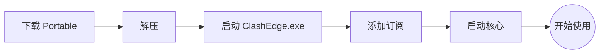
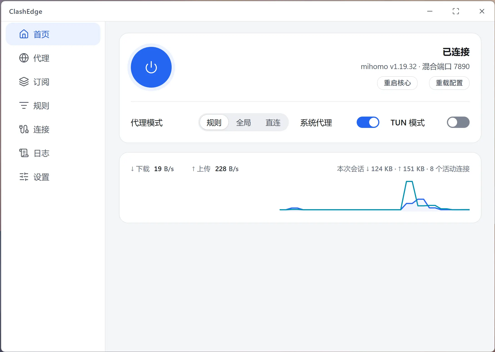
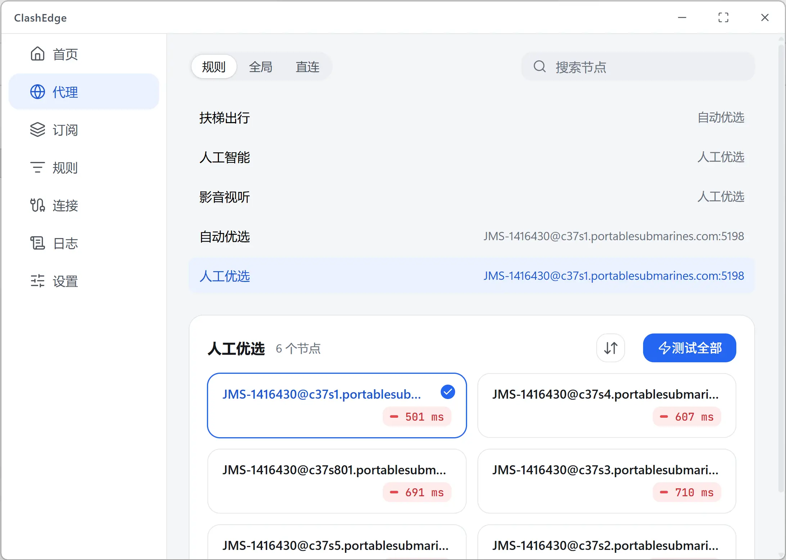
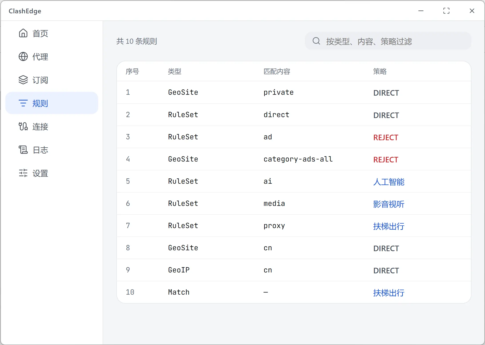
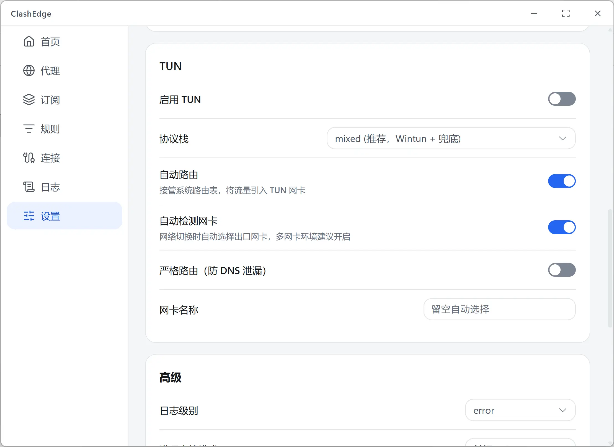
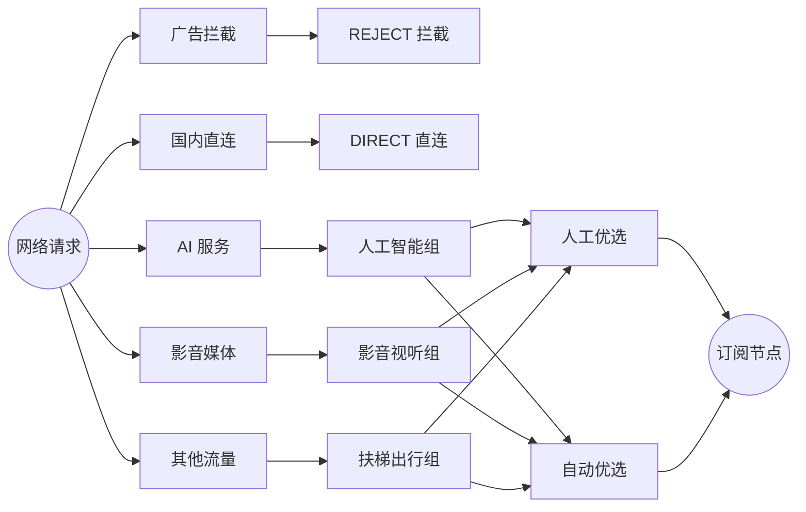

<div align="center">

# ClashEdge

**轻量、开箱即用的 Mihomo 客户端（Windows 正式发布 / Android 预览版）**

订阅提供节点，ClashEdge 负责分流与策略。内置规则开箱即用，也可自由配置。


[📥 下载](../../releases) · [📚 文档](docs/) · [🔧 规则库](https://github.com/akaspyrean/external) · [❓ 常见问题](docs/faq.md)

</div>

---

## 目录

- [平台对比](#平台对比)
- [核心特性](#核心特性)
- [快速开始](#快速开始)
- [界面预览](#界面预览)
- [智能分流体系](#智能分流体系)
- [文档导航](#文档导航)
- [相关仓库](#相关仓库)

---

## 平台对比

| 特性 | **ClashEdge for Windows** (正式版) | **ClashEdge for Android** (预览版) |
|------|-----------------------------------|-----------------------------------|
| **定位** | Lightweight / Portable / Windows-first | Lightweight / Simple / Mihomo-based |
| **内核接入** | Mihomo (sidecar) + WinTUN | Mihomo (Android AAR / JNI) |
| **网络方式** | 系统代理 + TUN (Wintun) | Android VpnService (TUN) |
| **分发形态** | 便携目录 (根启动器 + App/ + Data/) | APK |
| **前端技术** | Tauri 2 (Rust + Vue 3) | Kotlin + Jetpack Compose |
| **发布状态** | ✅ 正式发布 | 🔶 预览版 (无真实代理能力) |

> **Android 预览版说明**：自 v0.1.0 起进入发布链路——APK 由 CI 自动构建、签名并随 [Release](../../releases) 发布，可安装体验完整的界面与 VPN 授权流程；但 Mihomo 核心 (AAR/JNI) 仍为占位实现，**暂无法提供真实代理**。进入正式版的前置条件清单见 [`apps/android/README.md`](apps/android/README.md)。

两个平台共享品牌、产品定位、默认规则体系与相近的信息架构，但平台能力各自独立实现。

---

## 核心特性

### 📦 便携运行
- 解压即用，无需安装
- 整体迁移：复制文件夹即可迁移所有配置
- 支持中文路径、空格路径
- 程序与数据完全分离 (App/ + Data/)

### 🔗 订阅管理
- 订阅导入 / 更新 / 重命名
- 原始配置编辑 / User-Agent 自定义
- 导入导出 / 热重载
- 订阅流量 / 到期提醒 (Subscription-Userinfo)

### 🧭 分流策略
- **三种模式**：Rule (智能分流) / Global (全局代理) / Direct (直连)
- **五大策略组**：扶梯出行 / 人工智能 / 影音视听 / 人工优选 / 自动优选
- **两种节点选择**：人工优选 (手动) / 自动优选 (URL-Test 延迟测速)

### 🌐 系统网络
- 系统代理 (HTTP/HTTPS/SOCKS5)
- TUN 模式 (Wintun 驱动，需管理员权限)
- Mihomo 核心直连 (mixed-port / DNS / controller)

### 📊 状态体验
- 实时延迟监测 (六档分级：良好/一般/较差/超时/测速中/未测)
- 流量统计 / 活动连接 / 连接详情
- 核心日志 (级别筛选 + 正则搜索 + 导出)
- 中英双语 / 浅色深色主题 / 跟随系统

---

## 快速开始

### Windows (便携版)



1. 从 [Releases](../../releases) 下载 `ClashEdge-portable-win64.zip`
2. 解压到任意目录 (建议非系统盘，避免权限问题)
3. 运行 `ClashEdge.exe` (首次运行会自动创建 Data 目录)
4. 点击左侧「订阅」→「添加订阅」粘贴订阅链接
5. 点击首页「启动核心」按钮，核心状态变为「已连接」
6. 开启「系统代理」或「TUN 模式」即可使用

> **首次运行提示**：开启 TUN 模式需要管理员权限，程序会自动请求 UAC 提权。

### Android (预览版)

1. 从 [Releases](../../releases) 下载 `ClashEdge-android-<version>.apk`
2. 安装 APK (需允许"未知来源应用")
3. 打开应用，授予 VPN 权限
4. 添加订阅 → 启动核心
5. **注意**：当前预览版无真实代理能力，仅可体验界面与 VPN 授权流程

---

## 界面预览

| 首页 (仪表盘) | 代理管理 |
|--------------|---------|
|  |  |

| 订阅管理 | 设置 |
|---------|------|
|  |  |

---

## 智能分流体系

### 分流逻辑



### 规则优先级 (内置规则链)

```
GEOSITE,private
→ RULE-SET,direct (直连规则)
→ RULE-SET,ad (广告拦截)
→ GEOSITE,category-ads-all
→ RULE-SET,ai (AI 服务)
→ RULE-SET,media (影音媒体)
→ RULE-SET,proxy (代理规则)
→ GEOSITE,cn
→ GEOIP,CN
→ MATCH → 扶梯出行
```

### 策略组说明

| 策略组 | 类型 | 说明 |
|--------|------|------|
| **扶梯出行** | Select | 主代理组，含"自动优选"、"人工选择" |
| **人工智能** | Select | AI 服务专用，优先人工选择 |
| **影音视听** | Select | 视频/音乐流媒体专用，优先人工选择 |
| **自动优选** | URL-Test | 每 5 分钟测速，选延迟最低节点 (容差 50ms) |
| **人工选择** | Select | 手动选择节点，包含所有有效订阅节点 |
| **GLOBAL** | Select | 隐藏组，Global 模式下使用 |

---

## 文档导航

### 📖 用户文档

| 文档 | 说明 |
|------|------|
| [快速上手指南](docs/getting-started.md) | 30 秒上手、常见问题、故障排查 |
| [配置详解](docs/configuration.md) | 订阅、规则、DNS、TUN、代理组完整配置说明 |
| [界面使用手册](docs/ui-guide.md) | 各页面功能详细介绍、快捷键、操作技巧 |
| [常见问题 (FAQ)](docs/faq.md) | 安装、连接、订阅、更新、杀毒软件误报等 |

### 🔧 开发文档

| 文档 | 说明 |
|------|------|
| [架构设计](docs/architecture.md) | 系统架构、核心模块、数据流、不变量 |
| [设计系统](docs/design-system.md) | Clear Edge v2 设计规范 (Token、组件、交互) |
| [UI 重构指令](docs/redesign/AI_DEV_INSTRUCTIONS.md) | AI 编码代理执行的逐卡开发任务 |
| [源码审计报告](docs/audit/AUDIT-2026-10-08.md) | 完整代码审计、风险评级、修复状态 |
| [构建与发布](docs/build-release.md) | 本地构建、CI 流水线、签名发布、便携包制作 |

### 📦 打包与部署

| 文档 | 说明 |
|------|------|
| [便携包结构](docs/packaging/portable-layout.md) | 三分离布局、Data 目录、启动器行为 |
| [Windows 打包脚本](docs/packaging/windows-build.md) | build-portable.ps1、prepare.ps1、scan-portable-paths.ps1 |
| [Android 构建](apps/android/README.md) | Gradle 配置、签名、Mihomo AAR 接入 |

---

## 相关仓库

| 仓库 | 用途 | 关联 |
|------|------|------|
| [akaspyrean/external](https://github.com/akaspyrean/external) | **规则集与配置模板** | 内置规则来源、Parser 配置、Shadowrocket 配置 |
| [Mihomo](https://github.com/MetaCubeX/mihomo) | 核心内核 | ClashEdge 的底层代理引擎 |

### 规则库使用

ClashEdge 内置的规则集来源于 [`akaspyrean/external`](https://github.com/akaspyrean/external)，包含：

- **direct** - 直连域名/IP (110,890 条)
- **proxy** - 代理域名/IP (27,244 条)
- **ai** - AI 服务域名 (82 条)
- **media** - 影音媒体域名 (1,578 条)
- **ad** - 广告拦截域名 (215,689 条)

规则集通过签名清单机制验证完整性，每日自动更新，无需手动干预。

---

## 许可与声明

- **许可证**：[MIT License](LICENSE)
- **第三方声明**：[THIRD_PARTY_NOTICES.md](THIRD_PARTY_NOTICES.md)
- **用途声明**：仅用于网络配置、代理管理与技术研究
- **合规提示**：使用者应自行确认相关配置、规则及网络服务符合所在地法律法规及服务条款

---

<div align="center">

**ClashEdge** — 下载 · 解压 · 添加订阅 · 使用

[Releases](../../releases) · [External Rules](https://github.com/akaspyrean/external) · [Issue 反馈](../../issues)

</div>