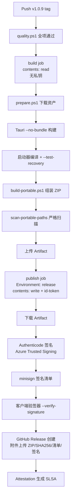

# 构建与发布流程

> 完整的本地开发构建、CI 质量门、发布签名流水线说明。

---

## 🛠️ 本地开发环境

### 前置依赖

| 工具 | 版本要求 | 安装方式 |
|------|----------|----------|
| **Rust** | 1.79+ (见 `rust-toolchain.toml`) | `rustup` |
| **Node.js** | 20 LTS | `nvm` / `fnm` / 官网 |
| **pnpm** | 9+ | `corepack enable && corepack prepare pnpm@latest --activate` |
| **PowerShell** | 7+ (推荐) / 5.1 | 系统自带 / GitHub Release |
| **Git** | 2.40+ | 系统自带 / 官网 |
| **7-Zip** | 23+ | 可选，用于解压测试 |
| **minisign** | 0.11+ | `cargo install minisign` / 官网 |
| **Visual Studio** | 2022 17.8+ (含 C#、Windows SDK) | 启动器编译需要 |

### 克隆与初始化
```bash
git clone https://github.com/akaspyrean/clashedge.git
cd clashedge

# 安装前端依赖
cd apps/windows
pnpm install

# 验证 Rust 工具链
cd ../src-tauri
cargo fetch
cargo check
```

---

## 🔨 本地构建

### 完整构建 (前端 + 后端 + 启动器 + 打包)

```powershell
# 1. 准备第三方资产 (mihomo、wintun、规则集、Geo 数据)
.\scripts\assets\prepare.ps1

# 2. 构建前端
cd apps/windows
pnpm run build

# 3. 构建 Rust 后端 (Release)
cd src-tauri
cargo build --release

# 4. 编译 C# 启动器
cd ../../../packaging/windows/launcher
msbuild ClashEdge.Launcher.csproj /p:Configuration=Release /p:Platform=x64

# 5. 组装便携包
cd ../../..
.\scripts\windows\build-portable.ps1

# 6. 验证产物
7z x dist/ClashEdge-portable-win64.zip -odist/test
.\scripts\windows\scan-portable-paths.ps1 -Path dist/test -Strict

# 7. 功能测试
cd dist/test
.\ClashEdge.exe
# 手动验证：启动核心、系统代理、TUN、订阅导入、节点切换
```

### 仅前端开发 (热重载)
```bash
cd apps/windows
pnpm run dev        # Vite dev server + Tauri dev 模式
```

### 仅后端开发
```bash
cd apps/windows/src-tauri
cargo run           # 调试模式
cargo test          # 运行测试
cargo clippy --all-targets -- -D warnings  # 静态检查
```

---

## ✅ 质量门

### 统一质量脚本
```powershell
# 仓库根目录运行
.\scripts\ci\quality.ps1
```

### 检查项目清单

| 类别 | 命令 | 说明 |
|------|------|------|
| **Rust 格式** | `cargo fmt --check --all` | 代码风格 |
| **Rust Clippy** | `cargo clippy --all-targets -- -D warnings` | 静态分析，零警告 |
| **Rust 测试** | `cargo test --all-targets` | 单元/集成测试 (183 项) |
| **Rust Audit** | `cargo audit` | 依赖漏洞扫描 |
| **Rust Deny** | `cargo deny check` | 许可证/重复依赖/来源检查 |
| **前端类型检查** | `vue-tsc --noEmit` | TypeScript 类型 |
| **前端测试** | `pnpm run test` | Vitest (26 项) |
| **前端构建** | `pnpm run build` | 生产构建验证 |
| **前端 Audit** | `pnpm audit --prod` | 依赖漏洞 |
| **启动器测试** | `ClashEdge.exe --test-recovery` | 故障注入 (70 断言) |
| **路径扫描** | `scan-portable-paths.ps1 -Strict` | 便携性验证 |

### 本地预提交检查 (推荐)
```powershell
# 快速检查 (仅格式+Clippy+前端类型)
cargo fmt --check && cargo clippy --all-targets -- -D warnings && cd apps/windows && vue-tsc --noEmit

# 完整检查 (推送前必跑)
.\scripts\ci\quality.ps1
```

---

## 🏷️ 版本管理

### 版本来源
- **单一真理源**：Git 标签 `v*` (如 `v1.0.9`)
- `tauri.conf.json` / `Cargo.toml` 中的版本为**开发时占位**，发布时由 CI 注入
- `src-tauri/src/update/mod.rs::current_version()` 读取编译时注入的版本

### 版本号规范
```
语义化版本: MAJOR.MINOR.PATCH
示例: 1.0.9, 1.1.0, 2.0.0

预发布: 1.0.9-beta.1, 1.0.9-rc.1
```

### Android versionCode 计算
```kotlin
// apps/android/app/build.gradle.kts
versionCode = major * 1_000_000 + minor * 1_000 + patch
// v1.0.9 -> 1000009
// v0.1.0 -> 1000 (预览版)
```

---

## 🚀 发布流程

### 触发条件
```yaml
# .github/workflows/release.yml
on:
  push:
    tags:
      - 'v*'  # 仅版本标签触发
```

> **标签不可变**：由 GitHub Rulesets (仓库设置) 强制，非脚本控制。

### 发布步骤 (自动化)



### 手动发布 (紧急修复/测试)

```powershell
# 1. 确保本地干净、main 分支最新
git status
git pull origin main

# 2. 打标签 (触发 CI)
git tag -a v1.0.9 -m "Release v1.0.9"
git push origin v1.0.9

# 3. 等待 CI 完成 (查看 Actions)

# 4. 如需手动干预 (极少见)
#   - 下载 build job Artifact
#   - 本地签名 (需证书)
#   - 手动创建 Release
```

---

## 🔐 签名体系

### 签名层级

| 层级 | 对象 | 算法 | 密钥管理 | 验证方 |
|------|------|------|----------|--------|
| **Authenticode** | `ClashEdge.exe` (根/内层) | SHA256 + RSA/ECDSA | Azure Trusted Signing / SignPath | Windows SmartScreen、杀毒软件 |
| **minisign** | `portable-manifest.json` | Ed25519 | 仓库 Secrets (`TAURI_SIGNING_PRIVATE_KEY`) | 客户端更新器、启动器 |
| **GitHub Attestation** | Release 产物 | SLSA Provenance | GitHub OIDC | 用户 `gh attestation verify` |

### 密钥管理
- **Authenticode PFX**：Azure Key Vault / SignPath，不落盘，CI 中临时签名
- **minisign 私钥**：GitHub Environment Secrets (`release` 环境)，仅 `publish` job 可读
- **minisign 公钥**：编译期注入客户端二进制 (`update/mod.rs::PUBLIC_KEY`)

### 验签流程 (客户端)
1. 下载 `portable-manifest.json` + `.minisig`
2. 内置公钥验签 `minisign -V -P <pubkey> -m manifest -s sig`
3. 校验通过 → 下载 ZIP → 校验 SHA256 → 启动器应用更新

### 启动器双重验签
1. 下载暂存区时：验证 ZIP SHA256 + minisign 清单签名
2. 应用更新前：调用**当前已安装内层程序** `--verify-staged` 复验 (不信任 `pending.json` 自带哈希)

---

## 📦 产物清单

每次 Release 产出：

| 文件 | 说明 | 大小约 |
|------|------|--------|
| `ClashEdge-portable-win64.zip` | Windows 便携包 | 60-80 MB |
| `ClashEdge-portable-win64.zip.sha256` | ZIP SHA256 | 64 字符 |
| `portable-manifest.json` | 更新清单 (版本、文件列表、哈希) | ~5 KB |
| `portable-manifest.json.minisig` | minisign 签名 | 96 字节 |
| `ClashEdge-android-<version>.apk` | Android 预览版 APK | ~15 MB |
| `ClashEdge-android-<version>.apk.sha256` | APK SHA256 | 64 字符 |

---

## 🧪 启动器故障注入测试

```powershell
# 运行完整测试套件
.\ClashEdge.exe --test-recovery
```

### 测试场景 (70 个断言)
| Kill Point | 场景 | 验证点 |
|------------|------|--------|
| `pending` | 下载完成、未验签 | 重试下载、清理损坏暂存 |
| `verified` | 验签通过、未应用 | 保留暂存、下次启动应用 |
| `swapping` | 备份中、替换前 | 回滚备份、保留暂存 |
| `committed` | 替换完成、未清理 | 清理暂存、标记成功 |
| `nojournal` | 无日志文件 (崩溃) | 从备份恢复、或全新安装 |
| `running-app` | 应用运行中双击启动器 | **跳过更新、保留暂存、仅唤醒窗口** |
| `move-failed` | Directory.Move 失败 | 回滚到 pending、保留暂存区 |

---

## 📋 发布检查清单

### 发布前 (维护者)
- [ ] `main` 分支最新，无未合并 PR
- [ ] `CHANGELOG.md` / Release Notes 已更新
- [ ] `quality.ps1` 本地全绿
- [ ] 版本号语义化正确 (无破坏性改动用 PATCH)
- [ ] Android 预览版同步构建 (如需)

### 发布中 (CI 监控)
- [ ] `build` job 绿 (含启动器 `--test-recovery`)
- [ ] `publish` job 绿 (签名、验签、上传)
- [ ] Release 页面产物完整 (6 个文件)
- [ ] Attestation 生成成功

### 发布后
- [ ] 下载 ZIP 校验 SHA256
- [ ] 解压测试：启动、核心、系统代理、TUN、订阅、更新检查
- [ ] 旧版本升级测试：覆盖安装、配置保留
- [ ] 发布通告 (Discussions/社群)

---

## 🔧 故障排查

### CI 失败常见原因

| 现象 | 排查 |
|------|------|
| `cargo clippy` 新警告 | Rust 版本更新导致新 lint，修复代码或更新 `rust-toolchain.toml` 固定版本 |
| `cargo deny` 许可证冲突 | 新依赖引入非兼容许可证，评估替代或添加例外 `deny.toml` |
| `npm audit` 高危漏洞 | 更新依赖或 `pnpm audit fix`，必要时 `overrides` |
| `scan-portable-paths` 报错 | 新增代码硬编码路径，改用相对路径/环境变量 |
| 启动器 `--test-recovery` 失败 | 查看 `Data/logs/launcher.log`，定位 kill point 逻辑 |
| Authenticode 签名失败 | 证书过期/吊锐、Azure 配额、网络超时 |

### 本地调试发布流程
```powershell
# 模拟 publish job (需配置环境变量)
$env:TAURI_SIGNING_PRIVATE_KEY = "<base64_private_key>"
$env:WINDOWS_CODESIGN_PFX_BASE64 = "<base64_pfx>"
$env:WINDOWS_CODESIGN_PASSWORD = "<password>"

# 下载 build Artifact (或本地 build 产物)
# 运行签名步骤
# 运行验签步骤
# 手动创建 Release (GitHub Web UI)
```

---

## 📚 相关文档

- [便携包结构](packaging/portable-layout.md) - 三分离布局、启动器行为
- [Windows 打包脚本](packaging/windows-build.md) - 脚本详细参数、自定义
- [架构设计](architecture.md) - 发布与更新章节
- [源码审计报告](audit/AUDIT-2026-10-08.md) - 供应链安全、B10/B11 修复状态

---

> **核心原则**：**标签触发、权限分离、双重验签、故障注入测试、便携性保证**。