# Windows 打包与发布脚本详解

> 说明 `scripts/windows/` 下的核心打包脚本用法、流程、自定义点。

---

## 📁 脚本概览

```
scripts/
├── assets/
│   └── prepare.ps1           # 第三方资产下载、校验、缓存、staging
├── ci/
│   └── quality.ps1           # 唯一质量门 (CI/Release 共用)
├── windows/
│   ├── build-portable.ps1    # 便携包组装 (主打包脚本)
│   └── scan-portable-paths.ps1  # 路径扫描/硬编码检测
└── release/
    └── make-update-manifest.py  # 更新清单生成 + minisign 签名
```

---

## 🔧 prepare.ps1 - 资产预处理

### 用途
下载并校验所有第三方二进制资产 (mihomo、wintun、规则集、Geo 数据)，生成 `build/assets/staging/` 供打包使用。

### 运行时机
- CI `build` job 开始前
- 本地开发打包前手动运行
- `build-portable.ps1` 内部自动调用 (可跳过 `--skip-prepare`)

### 核心逻辑
```powershell
# 1. 读取 assets.lock.json (版本、URL、SHA256 锁定)
$lock = Get-Content assets.lock.json | ConvertFrom-Json

# 2. 遍历每个资产
foreach ($asset in $lock.assets) {
    # 下载到缓存 (build/assets/cache/<sha256>.<ext>)
    # 支持多镜像 URL 兜底、断点续传、进度条
    
    # 校验 SHA256 (逐字节)
    # 失败 → 尝试下一个镜像 → 全部失败报错
    
    # 复制到 staging (build/assets/staging/<relative-path>)
}

# 3. 规则集与 Geo 数据
# 从 akaspyrean/external 固定 commit SHA 下载
# 验签 (minisign) + SHA256 + 内容校验
# 写入 staging/rules/、staging/geodata/
```

### assets.lock.json 结构
```json
{
  "version": 1,
  "updated_at": "2026-10-13T00:00:00Z",
  "assets": [
    {
      "name": "mihomo",
      "version": "1.19.20",
      "platforms": {
        "windows-amd64": {
          "url": "https://github.com/MetaCubeX/mihomo/releases/download/v1.19.20/mihomo-windows-amd64-compatible-v1.19.20.gz",
          "sha256": "abc123...",
          "mirrors": [...]
        }
      }
    },
    {
      "name": "wintun",
      "version": "0.14.1",
      "platforms": {
        "windows-amd64": {
          "url": "https://github.com/WireGuard/wintun/releases/download/v0.14.1/wintun-0.14.1-amd64.zip",
          "sha256": "def456...",
          "extract": "wintun.dll"
        }
      }
    }
  ],
  "external_rules": {
    "repo": "akaspyrean/external",
    "commit": "a1b2c3d4...",  # 固定 commit SHA
    "files": ["rules/*.yaml", "geodata/*.dat"]
  }
}
```

### 关键特性
- **绝不为未知二进制生成可信哈希**：所有哈希来自上游发布页或 `external` 仓库发布
- **固定 commit SHA**：`external` 规则集引用具体 commit，raw URL 永久不可变
- **多镜像兜底**：GitHub Release → 镜像站 → 备用 CDN
- **增量缓存**：缓存目录 `build/assets/cache/` 按 SHA256 命名，跨构建复用
- **Authenticode 校验**：wintun.dll 验证 WireGuard 签名发布者

### 常用参数
```powershell
# 完整准备 (默认)
.\scripts\assets\prepare.ps1

# 指定平台
.\scripts\assets\prepare.ps1 -Platform windows-amd64

# 跳过规则集 (仅内核/驱动)
.\scripts\assets\prepare.ps1 -SkipRules

# 强制重新下载 (清理缓存)
.\scripts\assets\prepare.ps1 -Force

# 详细输出
.\scripts\assets\prepare.ps1 -Verbose
```

---

## 🏗️ build-portable.ps1 - 便携包组装

### 用途
将 Tauri 构建产物 + `prepare.ps1` 的 staging 资产 + 默认配置模板组装成最终发布 ZIP。

### 运行时机
- CI `build` job 中 (Tauri `--no-bundle` 后)
- 本地发布测试

### 输入依赖
| 来源 | 路径 | 说明 |
|------|------|------|
| Tauri 构建 | `apps/windows/src-tauri/target/release/bundle/nsis/...` 或 `target/release/clashedge.exe` | `--no-bundle` 模式下直接取 `target/release/clashedge.exe` |
| 资产 staging | `build/assets/staging/` | `prepare.ps1` 产物 |
| 版本号 | `src-tauri/tauri.conf.json` → `package.version` | 或环境变量 `CLASHEDGE_RELEASE_VERSION` |

### 组装流程
```powershell
# 1. 创建临时工作目录
$workDir = New-TemporaryDirectory

# 2. 复制启动器 (已编译、已签名)
Copy-Item "launcher/bin/Release/ClashEdge.exe" "$workDir/ClashEdge.exe"

# 3. 创建 App/ClashEdge/
#   - 内层 exe (从 Tauri target/release 复制)
#   - sidecar/ (mihomo + wintun 从 staging 复制)
#   - resources/ (i18n、图标等)

# 4. 创建 App/DefaultData/
#   - config.yaml (默认配置模板)
#   - Country.mmdb, GeoIP.dat, GeoSite.dat (从 staging/geodata)
#   - rules/*.yaml (从 staging/rules)

# 5. 写入 portable.dat (便携标识)

# 6. 生成 Other/Help/README.md、Licenses/

# 7. 压缩为 ZIP (稳定文件名: ClashEdge-portable-win64.zip)
Compress-Archive -Path "$workDir/*" -DestinationPath "dist/ClashEdge-portable-win64.zip" -CompressionLevel Optimal

# 8. 计算 SHA256
Get-FileHash "dist/ClashEdge-portable-win64.zip" -Algorithm SHA256 | Out-File "dist/ClashEdge-portable-win64.zip.sha256"

# 9. 生成更新清单 (调用 make-update-manifest.py)
python scripts/release/make-update-manifest.py --version $version --zip "dist/ClashEdge-portable-win64.zip"
```

### 输出产物
```
dist/
├── ClashEdge-portable-win64.zip              # 发布包 (~60-80 MB)
├── ClashEdge-portable-win64.zip.sha256       # SHA256 校验文件
├── portable-manifest.json                    # 更新清单 (给客户端/启动器用)
└── portable-manifest.json.minisig            # minisign 签名
```

### portable-manifest.json 结构
```json
{
  "version": "1.0.9",
  "released_at": "2026-10-13T10:30:00Z",
  "min_client_version": "1.0.0",
  "files": [
    {
      "path": "ClashEdge.exe",
      "sha256": "abc123...",
      "size": 1234567
    },
    {
      "path": "App/ClashEdge/ClashEdge.exe",
      "sha256": "def456...",
      "size": 45678901
    },
    ...
  ],
  "notes": "Bug fixes and improvements"
}
```

### 常用参数
```powershell
# 标准打包 (内部调用 prepare.ps1)
.\scripts\windows\build-portable.ps1

# 跳过 prepare (已手动运行过)
.\scripts\windows\build-portable.ps1 -SkipPrepare

# 指定版本 (覆盖 tauri.conf.json)
.\scripts\windows\build-portable.ps1 -Version "1.0.9"

# 指定输出目录
.\scripts\windows\build-portable.ps1 -OutputDir "D:\Release"

# 启用 Authenticode 签名 (需环境变量)
.\scripts\windows\build-portable.ps1 -Sign
```

### 环境变量 (签名用)
| 变量 | 说明 | 必需 |
|------|------|------|
| `WINDOWS_CODESIGN_PFX_BASE64` | PFX 证书 Base64 | Authenticode 签名时 |
| `WINDOWS_CODESIGN_PASSWORD` | PFX 密码 | Authenticode 签名时 |
| `TAURI_SIGNING_PRIVATE_KEY` | minisign 私钥 (Base64) | 更新清单签名时 |
| `MINISIGN_PASSWORD` | minisign 私钥密码 | 如有密码 |

---

## 🔍 scan-portable-paths.ps1 - 路径扫描检测

### 用途
扫描打包产物中的硬编码绝对路径、用户名、临时路径等**便携性破坏因素**。

### 检测规则
| 模式 | 严重性 | 说明 |
|------|--------|------|
| `C:\Users\<username>` | Error | 用户配置目录硬编码 |
| `C:\Program Files` | Warning | 系统目录假设 |
| `%APPDATA%` / `%LOCALAPPDATA%` | Error | 环境变量依赖 (便携模式不应用) |
| `D:\900 AIWork` | Error | 开发机路径泄露 |
| `\\?\` / `\\.\` | Info | 设备路径 (通常无害) |

### 运行方式
```powershell
# 扫描指定目录 (默认 dist/ClashEdge-portable-win64 解压后)
.\scripts\windows\scan-portable-paths.ps1 -Path "dist/extracted"

# 严格模式 (Warning 视为 Error)
.\scripts\windows\scan-portable-paths.ps1 -Strict

# 输出 JSON (CI 解析)
.\scripts\windows\scan-portable-paths.ps1 -OutputJson "scan-result.json"
```

### CI 集成
```yaml
# .github/workflows/release.yml
- name: Scan portable paths
  run: |
    7z x dist/ClashEdge-portable-win64.zip -odist/extracted
    .\scripts\windows\scan-portable-paths.ps1 -Path dist/extracted -Strict -OutputJson scan.json
    # 失败则阻断发布
```

---

## 📝 make-update-manifest.py - 更新清单生成

### 用途
从打包产物生成 `portable-manifest.json` 并用 minisign 签名。

### 依赖
- Python 3.8+
- `minisign` 命令行工具 (或 Python `minisign` 库)
- 私钥文件或 Base64 环境变量

### 运行流程
```python
# 1. 遍历 ZIP 内所有文件，计算 SHA256、大小
# 2. 读取版本、构建时间、Release Notes
# 3. 生成 portable-manifest.json
# 4. 调用 minisign 签名
#    minisign -Sm portable-manifest.json -k private.key -p "password"
# 5. 输出 portable-manifest.json.minisig
```

### 参数
```bash
python scripts/release/make-update-manifest.py \
  --version 1.0.9 \
  --zip dist/ClashEdge-portable-win64.zip \
  --output dist/ \
  --notes-file RELEASE_NOTES.md \
  --private-key-env TAURI_SIGNING_PRIVATE_KEY \
  --password-env MINISIGN_PASSWORD
```

---

## 🔄 完整发布流水线

### 本地完整构建测试
```powershell
# 1. 准备资产
.\scripts\assets\prepare.ps1

# 2. 构建 Tauri (前端 + 后端)
cd apps/windows
npm ci
npm run build          # 前端构建
cd src-tauri
cargo build --release  # 后端构建

# 3. 编译启动器
cd ../../../packaging/windows/launcher
msbuild ClashEdge.Launcher.csproj /p:Configuration=Release

# 4. 组装便携包
cd ../../..
.\scripts\windows\build-portable.ps1

# 5. 扫描路径
7z x dist/ClashEdge-portable-win64.zip -odist/extracted
.\scripts\windows\scan-portable-paths.ps1 -Path dist/extracted -Strict

# 6. 验证安装
# 解压到测试目录，运行 ClashEdge.exe，功能冒烟测试
```

### CI/CD 流水线

```mermaid
flowchart LR
    A[Push v* tag] --> B[quality.ps1<br/>fmt/clippy/test/audit<br/>npm test/build/audit]
    B --> C[build job<br/>contents: read<br/>无私钥]
    C --> D[prepare.ps1<br/>下载资产]
    D --> E[Tauri --no-bundle<br/>cargo build --release]
    E --> F[启动器编译<br/>msbuild]
    F --> G[build-portable.ps1<br/>组装 ZIP]
    G --> H[scan-portable-paths<br/>硬编码检测]
    H --> I[上传构建产物<br/>Artifact]
    I --> J[publish job<br/>contents: write<br/>id-token: write<br/>Environment: release]
    J --> K[下载 Artifact]
    K --> L[Authenticode 签名<br/>Azure Trusted Signing]
    L --> M[minisign 签名清单]
    M --> N[客户端验签器<br/>--verify-signature]
    N --> O[GitHub Release<br/>附件上传]
    O --> P[Attestation 生成]
```



### 权限分离原则
| Job | 权限 | 说明 |
|-----|------|------|
| `build` | `contents: read` | 运行第三方构建代码 (npm、cargo)，**无私钥、无写权限** |
| `publish` | `contents: write`, `id-token: write`, `attestations: write` | 仅下载 Artifact + 签名 + 发布，**不运行第三方构建脚本** |

---

## 🛠️ 自定义与扩展

### 添加新第三方资产
1. 编辑 `assets.lock.json` 添加条目
2. 运行 `.\scripts\assets\prepare.ps1 -Force` 验证下载/校验
3. 确认 `build/assets/staging/` 出现文件
4. 打包脚本自动包含 (按 `staging/` 相对路径映射到 `App/`)

### 修改默认配置
编辑 `packaging/windows/portable/DefaultData/config.yaml`，重新打包即可。

### 支持新平台 (ARM64)
1. `assets.lock.json` 添加 `windows-arm64` 平台条目
2. `prepare.ps1` 支持 ARM64 下载/校验
3. Tauri 配置添加 `target: "aarch64-pc-windows-msvc"`
4. 启动器编译目标添加 ARM64
4. `build-portable.ps1` 输出 `ClashEdge-portable-win-arm64.zip`

---

## ❌ 常见构建失败

| 错误 | 原因 | 解决 |
|------|------|------|
| `prepare.ps1` SHA256 不匹配 | 上游文件变更 / 镜像损坏 | 更新 `assets.lock.json` 哈希，或检查镜像源 |
| `wintun.dll` 签名验证失败 | 非官方版本 / 文件损坏 | 确认从 WireGuard 官方 Release 下载 |
| `scan-portable-paths` 报错 | 代码/配置含硬编码路径 | 修复源码，使用相对路径或环境变量 |
| `minisign` 签名失败 | 私钥错误 / 密码错误 | 检查环境变量 `TAURI_SIGNING_PRIVATE_KEY` |
| ZIP 过大 (>100MB) | 资产重复 / 未清理 | 检查 `staging/` 是否有重复文件 |
| 启动器 `Mutex` 冲突 | 路径哈希算法变更 | 保持启动器 `GetPortableRoot` 逻辑稳定 |

---

> **提示**：所有脚本均为 PowerShell Core (7+) 兼容，Windows PowerShell 5.1 也可运行。CI 使用 `pwsh` 执行。